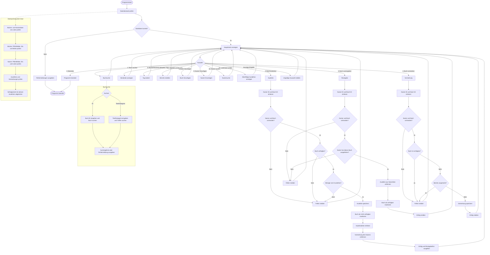

# Flowchart: Bibliotheks- und Ausleihsystem

Das folgende Flowchart bildet den Ablauf des Programms
`bibliothek_ausleihsystem.py` ab.

## Legende

- **Abgerundete Knoten**: Start oder Ende des Programms
- **Rechteckige Knoten**: Verarbeitung oder Ausgabe
- **Rauten**: Entscheidungen bzw. Bedingungen
- **Graue Abschnitte**: genauerer Ablauf in einem verarbeitenden Knoten
- **Pfeil zurück zum Hauptmenü**: Die Funktion ist abgeschlossen und der
  Menüzyklus wird fortgesetzt
